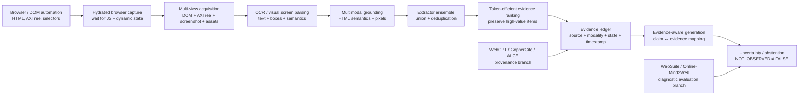

# Human–Agent Information Gap: Deep Research Landscape for LWA-Web

**Research cutoff:** 20 October 2026  
**Corpus:** 30 primary academic papers, technical reports, benchmark papers, and official browser/web-platform sources. Long author lists are abbreviated with *et al.* in the table; the linked landing pages contain complete bibliographic metadata.

## Executive summary

Your repository is already converging on a research question that the broader web-agent literature has only partially decomposed: **the important unit of failure is not simply “task success,” but the fate of individual pieces of human-accessible information as they move through the website → tool → agent → answer pipeline**. The repository formalizes exactly that sequence as four stages separated by three gaps: tool exposure, agent exploration/retrieval, and reporting/inference. Its current Daraz pilot is especially interesting because the observed failures occupy different stages: agents successfully interacted with dynamic SKU selectors, yet DOM-oriented observations omitted critical text embedded in images; separately, agents transformed purchase affordances into unsupported “in stock” claims and missing selector options into definitive incompatibility claims. fileciteturn2file0L1-L13 The prospective experiment makes this more rigorous by proposing human information-item inventories, modality labels, ecological browsing versus sealed text/pixel ablations, and separate retention/overreach measurements. fileciteturn4file0L1-L13

The literature strongly supports the **Gap 1 / exposure-barrier hypothesis**. Modern agents routinely receive impoverished representations: raw HTML is too large for practical model contexts, DOM/accessibility representations do not preserve every visual relation, text extractors disagree substantially about which page content survives, and client-side rendering can mean that the response HTML and eventual human-visible page are materially different. WebLINX explicitly motivates retrieval/pruning because complete webpages cannot practically be placed in LLM context; Pix2Struct, ScreenAI, SeeClick, and OmniParser show why screenshots and screen parsing provide information that HTML-centric observations do not; and the 2026 multi-extractor study demonstrates that different HTML-to-text extractors preserve surprisingly different slices of the web, with an extractor union raising retained token yield by as much as 71%. citeturn13search3turn17search0turn17search3turn18search0turn18search1turn20search3 Official Playwright and Google documentation independently confirms the systems mechanism: hydration can leave controls apparently ready before their event handlers work, while JavaScript-rendered content may simply not exist in an unrendered representation. citeturn20search0turn20search4turn20search5turn20search12

The **Gap 2 / exploration problem** is equally well supported but requires a different remedy. Mind2Web, SeeAct, WebSuite, WebLINX, VisualWebArena, and the recent WebArena-Lite trajectory audit all show that identifying the correct element, choosing what to inspect, scrolling sufficiently, executing the interaction, maintaining state, and recovering from failed actions are distinct bottlenecks that an end-to-end success score can hide. SeeAct is particularly relevant: with manually supplied grounding, GPT-4V could solve far more live tasks, identifying grounding as a major bottleneck; WebSuite goes further and deliberately decomposes failures by individual web-action category. citeturn14search0turn13search2turn14search3turn13search3turn13search1 The October 2026 WebArena-Lite audit is an unusually close match to your methodology: human trajectory review exposed scrolling loops, incomplete exploration, premature answers, invalid actions, and incomplete workflows that final-outcome evaluation alone obscured. citeturn14academia34

The most distinctive opportunity in your work is **Gap 3 / evidence semantics**. WebGPT, GopherCite, ALCE, and the new Failure-Transparent Agents benchmark establish that provenance, citation quality, uncertainty, abstention, and explicit evidence contracts materially improve reporting reliability, but most web-agent benchmarks still focus on whether an interaction task eventually succeeds. citeturn17search1turn16search1turn17search2turn15search1 Your “affordance overreach” and “negative-evidence overreach” categories therefore appear especially valuable: they test whether agents distinguish **observed positive evidence**, **observed negative evidence**, **absence of evidence**, and **inference**. Taken together, the literature suggests that LWA-Web should not be merely a better scraper. It should be a **hydrated, multimodal, multi-extractor evidence pipeline with explicit provenance, state-aware exploration, token-budgeted representations, and claim-level uncertainty/abstention**.

## Repository diagnosis

The repository is further along methodologically than a simple “agents miss image text” project. Its current experimental design has three separable research contributions.

First, it defines an **information-flow model rather than a model leaderboard**. The prospective protocol explicitly says the objective is not to determine which LLM is “smarter,” but to calculate information retention and drop-off across the four-stage pipeline. It defines Gap 1 as information unavailable to the tool, Gap 2 as information exposed by tools but never inspected, and Gap 3 as information retrieved but distorted—or absent information converted into unsupported confidence. fileciteturn4file0L1-L13 That decomposition is well aligned with the direction of WebSuite, BrowserGym-style diagnostic work, recent trajectory audits, and Failure-Transparent Agents, all of which argue implicitly or explicitly that aggregate success does not localize failure. citeturn14search3turn18search3turn14academia34turn15search1

Second, the pilot has already found evidence for **modality-dependent information loss**. Across three Daraz Bangladesh product listings, the paired agents could operate dynamic selectors and retrieve alternate SKU prices/URLs, while critical restrictions represented inside image pixels disappeared from DOM-based observations unless additional image-download/viewing steps were taken. fileciteturn2file0L1-L13 This is precisely the problem addressed from different directions by VisualWebArena, Pix2Struct, ScreenAI, SeeClick, OmniParser, and MMSearch-Plus: visually presented information cannot safely be assumed to have an equivalent textual or structured representation. citeturn13search1turn17search0turn17search3turn18search0turn18search1turn15search3

Third, the project has uncovered a potentially more publishable problem than simple extraction recall: **agents infer real-world propositions from interface states that do not entail those propositions**. The pilot reports six of six runs labeling products “in stock” from active purchase affordances despite empty stock fields, as well as repeated conversion of missing selector options into physical-incompatibility claims. fileciteturn2file0L1-L13 The next protocol now measures “Affordance Overreach Rate” and “Negative-Evidence Overreach Rate,” while the sealed B1 text-only versus B2 text-plus-pixels conditions are intended to distinguish tool omission from downstream reasoning error. fileciteturn4file0L1-L13 That connects directly to evidence-backed generation and abstention research, but the particular **“not observed ≠ false”** phenomenon is much less central in mainstream web-agent benchmarks; that gives LWA-Web a meaningful angle rather than making it another navigation benchmark. citeturn16search1turn17search2turn15search1

My main methodological recommendation is therefore to preserve the repository's pipeline model and make **information items and evidence states the primary experimental unit**. Task completion should remain a secondary ecological outcome. This lets LWA-Web answer the more interesting question: *at exactly which transformation did a fact disappear, become inaccessible, remain unexplored, or turn into an unsupported assertion?*

## Research corpus

The tables below contain **30 sources**. Priority was given to peer-reviewed ACL/EMNLP/ICML/ICLR/NeurIPS work, arXiv papers when the newest relevant work has not yet completed publication, major-lab research, and first-party browser/web infrastructure documentation.

**Core web-agent failure and evaluation literature**

| Title | Authors | Year | Venue | PDF / direct link | Short summary | Documented failure points | Mitigation / architecture | Relevance to LWA-Web |
|---|---|---:|---|---|---|---|---|---|
| **Mind2Web: Towards a Generalist Agent for the Web** | Xiang Deng, Yu Gu, Boyuan Zheng, Shijie Chen, Samuel Stevens, Boshi Wang, Huan Sun, Yu Su | 2023 | NeurIPS Datasets & Benchmarks | [PDF](https://proceedings.neurips.cc/paper_files/paper/2023/file/5950bf290a1570ea401bf98882128160-Paper-Datasets_and_Benchmarks.pdf) · [Landing](https://proceedings.neurips.cc/paper_files/paper/2023/hash/5950bf290a1570ea401bf98882128160-Abstract-Datasets_and_Benchmarks.html) | Establishes a large, diverse real-web task dataset rather than relying only on simulated sites. It also motivates reducing the web observation before LLM processing because complete pages contain too much irrelevant information. citeturn14search0 | Huge HTML; candidate-element selection; cross-site/domain generalization; multi-step interaction. | Rank/filter plausible elements before expensive LLM reasoning. | Direct precedent for **Gap 2** and for an LWA token-budgeted relevance stage. |
| **WebArena: A Realistic Web Environment for Building Autonomous Agents** | Shuyan Zhou, Frank F. Xu, Hao Zhu, Xuhui Zhou, Robert Lo, Abishek Sridhar, Xianyi Cheng, Tianyue Ou, Yonatan Bisk, Daniel Fried, Uri Alon, Graham Neubig | 2024 | ICLR | [PDF](https://arxiv.org/pdf/2307.13854) · [Landing](https://openreview.net/forum?id=oKn9c6ytLx) | Creates reproducible, functional web environments in which success can be evaluated from the resulting website state rather than just matching an action trace. It demonstrated how far autonomous agents remained from reliable web operation. citeturn14search1 | Planning, grounding, interaction and long-horizon failure; brittle evaluation on uncontrolled sites. | Self-hosted functional websites and outcome-based validators. | Useful template for the **task-level ecological layer** above LWA-Web's item-level gap metrics. |
| **GPT-4V(ision) is a Generalist Web Agent, if Grounded / SeeAct** | Boyuan Zheng, Boyu Gou, Jihyung Kil, Huan Sun, Yu Su | 2024 | ICML | [PDF](https://proceedings.mlr.press/v235/zheng24e/zheng24e.pdf) · [Landing](https://proceedings.mlr.press/v235/zheng24e.html) | Shows strong planning potential from a multimodal model but a large dependence on correct action grounding; with manual grounding, GPT-4V completed 51.1% of tested live tasks. The work explicitly separates reasoning about what to do from mapping that decision onto actual page elements. citeturn13search2 | Element grounding; mismatch between visual intention and executable page element; live-site variability. | Combine visual understanding with HTML/structured element information; evaluate online. | One of the cleanest precedents for separating **agent reasoning from tool/grounding failure**, matching Gap 1 versus Gap 2. |
| **VisualWebArena: Evaluating Multimodal Agents on Realistic Visual Web Tasks** | Jing Yu Koh et al. | 2024 | ACL | [PDF](https://aclanthology.org/2024.acl-long.50.pdf) · [Landing](https://aclanthology.org/2024.acl-long.50/) | Extends realistic web evaluation to tasks whose solution depends on both webpage images and text. Successful agents must jointly understand visual content, language instructions, and website actions rather than treating the page as text alone. citeturn13search1 | Text-only observations fail on visually grounded tasks; visual understanding and interaction remain difficult even for multimodal agents. | Multimodal webpage observations and visually grounded benchmark tasks. | Strong external justification for the repository's **IMAGE_TEXT / VISUAL_ONLY** modality categories. |
| **WebVoyager: Building an End-to-End Web Agent with Large Multimodal Models** | Hongliang He, Wenlin Yao, Kaixin Ma, Wenhao Yu, Yong Dai, Hongming Zhang, Zhenzhong Lan, Dong Yu | 2024 | ACL | [PDF](https://aclanthology.org/2024.acl-long.371.pdf) · [Landing](https://aclanthology.org/2024.acl-long.371/) | Demonstrates an end-to-end multimodal browser agent operating on 15 real-world websites and introduces an automated multimodal evaluation protocol. It helped establish screenshot-plus-interaction agents as an alternative to DOM-only browsing. citeturn13search0 | Open-ended website interaction; visual grounding; judging successful outcomes on live pages. | Repeated screenshot observation, multimodal reasoning and browser actions; model-based evaluator. | Good baseline architecture for **pixels + actions**, but LWA-Web can add stronger provenance and item-level accounting. |
| **WebLINX: Real-World Website Navigation with Multi-Turn Dialogue** | Xing Han Lù, Zdeněk Kasner, Siva Reddy | 2024 | ICML | [PDF](https://proceedings.mlr.press/v235/lu24e/lu24e.pdf) · [Landing](https://proceedings.mlr.press/v235/lu24e.html) | Provides roughly 100,000 interactions across about 2,300 expert demonstrations and more than 150 real sites. A central design problem is that LLMs cannot efficiently consume entire webpages, motivating retrieval-inspired ranking and pruning. citeturn13search3 | Context overload; irrelevant DOM; unseen-site generalization. | Rank relevant candidate elements and compress webpage state before reasoning. | Directly supports a **token-efficient evidence-selection layer** rather than shipping raw DOM into LWA-Web's LLM. |
| **WebSuite: Systematically Evaluating Why Web Agents Fail** | Eric Li, Jim Waldo | 2024 | arXiv technical report | [PDF](https://arxiv.org/pdf/2406.01623) · [Landing](https://arxiv.org/abs/2406.01623) | WebSuite argues that end-to-end success does not tell researchers *why* a web agent failed. It develops a hierarchical taxonomy of web actions and diagnostic tasks so failures can be attributed to specific interactions. citeturn14search3turn14search7 | Aggregate metrics hide click, link, form, navigation and other low-level failures. | Action-taxonomy evaluation plus both isolated and end-to-end tasks. | Very close philosophically to your **three-gap decomposition**; useful blueprint for diagnostic annotation. |
| **AgentOccam: A Simple Yet Strong Baseline for LLM-Based Web Agents** | Ke Yang, Yao Liu, Sapana Chaudhary, Rasool Fakoor, Pratik Chaudhari, George Karypis, Huzefa Rangwala | 2025 | ICLR | [PDF](https://arxiv.org/pdf/2410.13825) · [Landing](https://openreview.net/forum?id=oWdzUpOlkX) | Shows that substantial gains can come from refining the observation and action spaces rather than adding ever more elaborate agent machinery. The central lesson is that representation alignment with the LLM is itself a major performance lever. citeturn19search1turn19search5 | Noisy/poorly aligned observations and action interfaces impose unnecessary reasoning burden. | Simplify and redesign observation/action representations. | Supports LWA-Web's goal of producing a **small, information-preserving intermediate representation**. |
| **An Illusion of Progress? Assessing the Current State of Web Agents / Online-Mind2Web** | Tianci Xue, Weijian Qi, Tianneng Shi, Chan Hee Song, Boyu Gou, Dawn Song, Huan Sun, Yu Su | 2025 | COLM | [PDF](https://arxiv.org/pdf/2504.01382) · [Landing](https://openreview.net/forum?id=6jZi4HSs6o) | Re-evaluates web agents on live sites through Online-Mind2Web and argues that static/cached benchmarks can exaggerate progress because websites drift, tasks become invalid, and live access adds new barriers. It introduces 300 live tasks spanning 136 websites and a WebJudge evaluator. citeturn19search0turn19search4 | Website drift, stale tasks, CAPTCHA/access issues, benchmark shortcuts, hallucinated interpretations of live results. | Live evaluation, manual validity checking and outcome judging. | Essential support for your **frozen-capture + live-ecological dual design**. |
| **Beyond Browsing: API-Based Web Agents** | Yueqi Song, Frank F. Xu, Shuyan Zhou, Graham Neubig | 2025 | Findings of ACL | [PDF](https://aclanthology.org/2025.findings-acl.577.pdf) · [Landing](https://aclanthology.org/2025.findings-acl.577/) | Tests APIs as an alternative information/action surface to graphical browsing and finds that API-only agents outperform browsing-only agents on WebArena, while hybrid browsing/API agents perform best. The hybrid system reached a reported 38.9% task success and exceeded browsing alone by more than 24 percentage points. citeturn19search2turn19search26 | Browsers can be an inefficient or ambiguous machine interface even when structured APIs exist. | Dynamically choose between browser interaction and API access. | Strong argument for **multi-surface acquisition**: DOM/visual browser plus official structured endpoints when available. |
| **Auditing Web Agent Evaluation on WebArena-Lite: Human Review of Outcomes and Trajectories** | Chengguang Gan, Zimeng He, Yoshihiro Tsujii, Ken-ichiro Kobayashi, Hiroki Itoh, Kotaro Funakoshi | 2026 | arXiv | [PDF](https://arxiv.org/pdf/2610.01491) · [Landing](https://arxiv.org/abs/2610.01491) | Audits all 165 WebArena-Lite tasks under several agent/evaluator conditions and finds meaningful disagreement between automatic final-outcome scores and human trajectory review. Its failure analysis identifies scrolling loops, unfinished exploration, premature answers, invalid actions and incomplete workflows; explicit execution-state support also improves results. citeturn14academia34 | Evaluator false negatives; hidden partial progress; loops; premature termination; incomplete exploration. | Human-grounded trajectory auditing, explicit execution-state memory, procedural guidance. | Excellent model for **Gap 2 trace adjudication** rather than relying only on final answers. |

**Web extraction, visual grounding and representation**

| Title | Authors | Year | Venue | PDF / direct link | Short summary | Documented failure points | Mitigation / architecture | Relevance to LWA-Web |
|---|---|---:|---|---|---|---|---|---|
| **WebSRC: A Dataset for Web-Based Structural Reading Comprehension** | Xingyu Chen, Zihan Zhao, Lu Chen, Jiabao Ji, Danyang Zhang, Ao Luo, Yuxuan Xiong, Kai Yu | 2021 | EMNLP | [PDF](https://aclanthology.org/2021.emnlp-main.343.pdf) · [Landing](https://aclanthology.org/2021.emnlp-main.343/) | Contains roughly 400,000 QA pairs from 6,400 webpages together with HTML, screenshots and metadata. Questions require understanding webpage structure rather than treating extracted text as an ordinary linear document. citeturn16search0 | Flattened text loses spatial/logical relations between attributes and values. | Joint use of page structure and visual/HTML information. | Supports a **structure-preserving evidence representation** rather than plain Markdown alone. |
| **Pix2Struct: Screenshot Parsing as Pretraining for Visual Language Understanding** | Kenton Lee, Mandar Joshi, Iulia Turc, Hexiang Hu, Fangyu Liu, Julian Eisenschlos, Urvashi Khandelwal, Peter Shaw, Ming-Wei Chang, Kristina Toutanova | 2023 | ICML | [PDF](https://proceedings.mlr.press/v202/lee23g/lee23g.pdf) · [Landing](https://arxiv.org/abs/2210.03347) | Pretrains an image-to-text system by recovering simplified HTML from masked webpage screenshots. The objective effectively combines signals normally split across OCR, layout analysis, language modeling and image understanding. citeturn17search0turn17search28 | OCR/text pipelines alone cannot capture all visually situated language and layout relations. | Pixel-native variable-resolution representation and screenshot-to-structured-text learning. | Conceptual precedent for turning LWA screenshots into **compact structured visual evidence**. |
| **ScreenAI: A Vision-Language Model for UI and Infographics Understanding** | Gilles Baechler et al. | 2024 | IJCAI / Google Research | [PDF](https://arxiv.org/pdf/2402.04615) · [Landing](https://arxiv.org/abs/2402.04615) | Specializes vision-language modeling for screens, UIs and infographics, including a screen-annotation task that identifies element types and locations. Those annotations can be converted into training data for QA, navigation and summarization. citeturn17search3 | Important screen information is spatial and visual rather than faithfully recoverable as linear text. | Element type/location annotation plus screenshot-based VLM understanding. | Useful design for an **image/diagram extraction fallback** behind the normal DOM extractor. |
| **SeeClick: Harnessing GUI Grounding for Advanced Visual GUI Agents** | Kanzhi Cheng, Qiushi Sun, Yougang Chu, Fangzhi Xu, Yantao Li, Jianbing Zhang, Zhiyong Wu | 2024 | ACL | [PDF](https://aclanthology.org/2024.acl-long.505.pdf) · [Landing](https://aclanthology.org/2024.acl-long.505/) | Identifies GUI grounding—the ability to locate the correct screen element from an instruction—as a central weakness of visual GUI agents. It introduces grounding-specific pretraining and ScreenSpot, covering mobile, desktop and web interfaces. citeturn18search0 | Incorrect localization even when the model semantically understands the task; structured representations may be lengthy or unavailable. | Large-scale GUI-grounding data and screenshot-only localization. | Provides a measurable **visual-grounding subtask** for Gap 2. |
| **OmniParser for Pure Vision Based GUI Agent** | Yadong Lu, Jianwei Yang, Yelong Shen, Ahmed Awadallah | 2024 | arXiv / Microsoft Research | [PDF](https://arxiv.org/pdf/2408.00203) · [Landing](https://arxiv.org/abs/2408.00203) | Parses screenshots into explicit interactable regions plus semantic descriptions using specialized detection and caption models. The resulting structured screen representation substantially improves downstream visual action grounding. citeturn18search1turn18search5 | Generic multimodal models struggle to identify interactable icons and connect their semantics to exact regions. | Detector + semantic captioner → structured screen elements. | Probably the closest off-the-shelf pattern for an LWA **visual evidence parser** that complements DOM/AXTree data. |
| **Cleaner Pretraining Corpus Curation with Neural Web Scraping / NeuScraper** | Zhipeng Xu, Zhenghao Liu, Yukun Yan, Zhiyuan Liu, Ge Yu, Chenyan Xiong | 2024 | ACL Short Papers | [PDF](https://aclanthology.org/2024.acl-short.72.pdf) · [Landing](https://aclanthology.org/2024.acl-short.72/) | Argues that increasingly complex webpages weaken hand-written rule and shallow-feature scrapers. NeuScraper uses a lightweight neural architecture and page/layout signals to identify primary clean text, outperforming the tested scraper baselines by more than 20%. citeturn18search6 | Rule-based main-content extraction breaks on diverse page structures and admits boilerplate or loses content. | Lightweight neural semantic/layout extraction. | Candidate **cheap first-stage extractor** before expensive browser/vision escalation. |
| **Dripper: Token-Efficient Main HTML Extraction with a Lightweight LM** | Mengjie Liu et al. | 2025 | arXiv | [PDF](https://arxiv.org/pdf/2511.23119) · [Landing](https://arxiv.org/abs/2511.23119) | Dripper explicitly targets context-window cost, inference expense and format hallucination in LLM-based HTML extraction. It simplifies HTML to about 22% of the original token load, reframes extraction as block classification and constrains generation; it also introduces WebMainBench with more than 7,800 human-annotated pages. citeturn15search2 | Raw-HTML token explosion; costly generation; hallucinated extraction format. | HTML simplification, semantic block classification, constrained decoding, fallback strategy. | Highly relevant implementation reference for the **“lightweight” part of LWA-Web**. |
| **Beyond a Single Extractor: Re-thinking HTML-to-Text Extraction for LLM Pretraining** | Jeffrey Li et al. | 2026 | Findings of EACL | [PDF](https://aclanthology.org/2026.findings-eacl.307.pdf) · [Landing](https://arxiv.org/abs/2602.19548) | Shows that superficially comparable HTML extractors retain significantly different pages/content and that committing to one extractor leaves recoverable information behind. Taking a union across extractors increased token yield by up to 71%; extractor choice also produced large downstream differences for structured tables and code. citeturn20search3turn20search7 | Single-extractor blind spots; loss of tables/code/structured data; inconsistent page survival. | Union/ensemble of heterogeneous extractors instead of one canonical parser. | **High-priority architectural evidence** for union-then-deduplicate extraction in LWA-Web. |
| **LiveWeb-IE: A Benchmark for Online Web Information Extraction** | Seungbin Yang, Jihwan Kim, Jaemin Choi, Dongjin Kim, Soyoung Yang, ChaeHun Park, Jaegul Choo | 2026 | arXiv | [PDF](https://arxiv.org/pdf/2603.13773) · [Landing](https://arxiv.org/abs/2603.13773) | Directly argues that snapshot-based web-information-extraction evaluation does not capture temporally changing live webpages. It introduces live extraction queries across text, image and hyperlink categories and proposes a Visual Grounding Scraper that visually narrows pages before extracting requested information. citeturn15search0 | Static benchmarks age; live pages evolve; heterogeneous data categories; locating the relevant region on a complex page. | Multi-stage Visual Grounding Scraper; live-site benchmark with graded extraction complexity. | Perhaps the **closest contemporary paper to LWA-Web's core question**, especially for online versus frozen evaluation. |
| **WCXB: A Multi-Type Web Content Extraction Benchmark** | Murrough Foley | 2026 | arXiv | [PDF](https://arxiv.org/pdf/2605.21097) · [Landing](https://arxiv.org/abs/2605.21097) | Builds a 2,008-page benchmark across 1,613 domains and seven structurally different webpage types rather than evaluating only old news/article pages. Extraction systems converge on articles but diverge sharply on products, listings, documentation and other structured page types. citeturn15academia7 | Article-centric extraction benchmarks conceal failures on diverse structured websites. | Multi-page-type benchmark with human-reviewed ground truth and per-type F1. | Excellent dataset-design precedent for your planned **Retail / Services / Public / Documentation strata**. |
| **MMSearch-Plus: Benchmarking Provenance-Aware Search for Multimodal Browsing Agents** | Xijia Tao, Yihua Teng, Xinxing Su, Xinyu Fu, Jihao Wu, Chaofan Tao, Ziru Liu, Haoli Bai, Rui Liu, Lingpeng Kong | 2026 | ICLR | [PDF](https://arxiv.org/pdf/2508.21475) · [Landing](https://arxiv.org/abs/2508.21475) | Constructs browsing questions in which weak, localized visual signals—micro-text, layouts, signage and part-level appearance—must be detected and then propagated into further web searches. The benchmark additionally tests provenance verification under noisy retrieval instead of treating a final correct answer as sufficient. citeturn12search0turn15search3 | Tiny visual evidence; provenance confusion; noisy retrieval; long-horizon image-to-text evidence chaining. | Bounding-box/crop-based visual evidence seeking plus iterative cross-validation. | Strong future benchmark model for **pixels → evidence object → provenance-preserving retrieval**. |

**Evidence, hallucination, provenance and uncertainty**

| Title | Authors | Year | Venue | PDF / direct link | Short summary | Documented failure points | Mitigation / architecture | Relevance to LWA-Web |
|---|---|---:|---|---|---|---|---|---|
| **WebGPT: Browser-Assisted Question-Answering with Human Feedback** | Reiichiro Nakano et al. | 2021 | OpenAI technical report / arXiv | [PDF](https://cdn.openai.com/WebGPT.pdf) · [Landing](https://arxiv.org/abs/2112.09332) | WebGPT gives a language model a textual browser and requires it to collect references during browsing so humans can audit the factual basis of long-form answers. It trains browsing and answer generation with demonstrations and preference feedback rather than generating unsupported responses directly from model memory. citeturn17search1 | Ungrounded long-form answers are difficult to verify; browsing without retained evidence does not establish provenance. | Evidence collection during browsing plus source-backed answer generation. | Foundational precedent for an LWA **evidence ledger linked to output claims**. |
| **Teaching Language Models to Support Answers with Verified Quotes / GopherCite** | Jacob Menick et al. | 2022 | DeepMind technical report / arXiv | [PDF](https://arxiv.org/pdf/2203.11147) · [Landing](https://arxiv.org/abs/2203.11147) | Trains open-book models to answer using explicit supporting evidence and to abstain when uncertain. Rejecting the third of questions with greatest uncertainty improved reported human-rated answer quality from 80% to 90% on the studied Natural Questions subset and from 67% to 80% on the ELI5 subset, while the authors also stress that citation alone does not guarantee truth. citeturn16search1 | Hallucination; unsupported claims; over-answering under uncertainty; evidence can be relevant yet still support a false inference. | Evidence-backed generation and explicit abstention/selective answering. | Direct conceptual solution to your **negative-evidence and silent-field problem**. |
| **Enabling Large Language Models to Generate Text with Citations / ALCE** | Tianyu Gao, Howard Yen, Jiatong Yu, Danqi Chen | 2023 | EMNLP | [PDF](https://aclanthology.org/2023.emnlp-main.398.pdf) · [Landing](https://aclanthology.org/2023.emnlp-main.398/) | Introduces a reproducible framework for long-form generation with citations rather than treating citations as a cosmetic feature. Its automated evaluation separates answer fluency/correctness from citation quality and supports multiple evidence passages for individual statements. citeturn17search2 | Hallucinations; missing citations; citations that do not sufficiently support their associated claims. | Claim-level citation generation and explicit citation-quality evaluation. | Gives LWA-Web a ready-made model for **provenance precision/completeness metrics** at Gap 3. |
| **Failure-Transparent Agents: Benchmarking Post-Failure Reporting in Tool-Using Language Models** | Junru Zhu, Shiming Xie, Aime Lu Fan Chen, Xiaoqing Ding, Chunxin Tang, Ruoyu Qi, Yulang Fei | 2026 | arXiv; submitted to ICASSP 2027 | [PDF](https://arxiv.org/pdf/2609.35732) · [Landing](https://arxiv.org/abs/2609.35732) | Separates tool failure from the second failure of falsely reporting that the requested result was obtained. Across its controlled experiments, a structured evidence contract reduced false-success reporting from 22.8% under the baseline policy to 0.8%, while also sharply reducing fabricated details. citeturn15search1 | False-success statements after a failed tool call; fabricated details; user pressure encouraging overclaiming. | Structured evidence contract and explicit failure-transparency instruction. | **Extremely close to Gap 3.** Its evidence-contract idea should be adapted to `OBSERVED / NOT_OBSERVED / INFERRED / UNKNOWN`. |

**Official browser, rendering and anti-automation sources**

| Title | Author / owner | Year | Venue | Direct link | Short summary | Documented failure points | Mitigation / architecture | Relevance to LWA-Web |
|---|---|---:|---|---|---|---|---|---|
| **Playwright: Navigations and Actionability** | Microsoft / Playwright | current docs | Official documentation | [Navigations](https://playwright.dev/docs/navigations) · [Actionability](https://playwright.dev/docs/actionability) | Playwright documents a concrete hydration failure in which a page can display enabled-looking controls before JavaScript handlers are attached, causing clicks to be ignored or form contents to be reset. It also automatically waits for actionability conditions before operations such as clicks. citeturn20search0turn20search4 | Hydration races; visually ready but functionally unready controls; timing-dependent actions. | Hydration-aware waiting, locator/actionability checks and state synchronization. | LWA-Web should distinguish **network response received** from **render/state stabilized** before extraction. |
| **Selenium WebDriver: Waiting Strategies** | Selenium Project | current docs | Official documentation | [WebDriver waits](https://www.selenium.dev/documentation/webdriver/waits/) | Selenium documents explicit and implicit waiting as mechanisms for synchronizing automation with asynchronously available page state. Its documentation also warns that mixing wait strategies can create unpredictable timing behavior. citeturn3search1 | Dynamic elements appear after initial load; race conditions between automation and UI state. | Explicit condition-based waits rather than fixed assumptions about page readiness. | Useful cross-tool confirmation that **dynamic-state stabilization is a first-class acquisition problem**, not merely an LLM problem. |
| **Google Search Central: JavaScript SEO / Dynamic Rendering** | Google | current docs | Official documentation | [JavaScript SEO basics](https://developers.google.com/search/docs/crawling-indexing/javascript/javascript-seo-basics) · [Dynamic rendering](https://developers.google.com/search/docs/crawling-indexing/javascript/dynamic-rendering) | Google documents that JavaScript-generated content may require a rendering stage before it becomes visible to an automated consumer; without rendering, content that humans see may not appear in the initial representation. Google describes dynamic rendering as a workaround rather than the preferred long-term approach. citeturn20search1turn20search5turn20search12 | Client-side rendering; shadow/web-component handling; delayed/lazy content; crawler/render disparity. | Render the page, validate rendered HTML and prefer robust server/static/hydrated delivery when designing sites. | Strong independent support for a formal **browser-hydration stage before LWA extraction**. |
| **Cloudflare Bot Management / Scraping Detections** | Cloudflare | current docs | Official documentation | [Bot solutions](https://developers.cloudflare.com/bots/) · [Scraping detections](https://developers.cloudflare.com/bots/additional-configurations/detection-ids/scraping-detections/) | Cloudflare explicitly identifies scraping as automated activity its bot products can detect and challenge, and supports rules based on bot scores and scraping detections. Thus a web agent may receive a challenge/blocked representation instead of the human content it sought. citeturn20search2turn20search6turn20search10 | Bot classification, challenges, blocked/headless requests and content-access asymmetry. | From the LWA side, **detect and report the access barrier rather than silently interpreting a challenge page as the target page**; prefer authorized APIs or permissible access channels. | Add `ACCESS_BLOCKED / BOT_CHALLENGE` as a Gap-1 state so anti-scraping does not masquerade as “information absent.” |

## Failure patterns and recurring mitigations

Across this corpus, the failures fit your repository's three gaps unusually cleanly.

| Pipeline location | Recurring failure mode | Representative evidence | Recurring mitigation | Recommended LWA-Web interpretation |
|---|---|---|---|---|
| **Gap 1: website → tool** | Text exists only in image pixels, diagrams, banners or visual relationships. | VisualWebArena, Pix2Struct, ScreenAI, MMSearch-Plus. citeturn13search1turn17search0turn17search3turn15search3 | Screenshot capture, OCR/VLM screen parsing, element bounding boxes, multimodal retrieval. | A DOM miss is **not** evidence that the page lacks the fact. |
| **Gap 1** | Initial HTML differs from hydrated/rendered page. | Playwright and Google rendering documentation. citeturn20search0turn20search12 | Real browser rendering, condition-based waits, state stabilization, re-capture after interactions. | Record `render_state` and do not treat initial-response HTML as canonical. |
| **Gap 1** | Main-content extractors silently drop different material, especially structured content. | NeuScraper, Dripper, Beyond a Single Extractor, WCXB. citeturn18search6turn15search2turn20search3turn15academia7 | Heterogeneous extractor ensemble, semantic extraction, union before deduplication. | Store extractor disagreement as useful uncertainty rather than selecting one extractor as truth. |
| **Gap 1** | Bot defense substitutes challenge/blocked content for the intended page. | Cloudflare docs; Online-Mind2Web's live-web motivation. citeturn20search2turn19search0 | Detect access-barrier pages, use legitimate structured interfaces where available, expose failure to the reasoner. | `ACCESS_BLOCKED` must differ from `FIELD_ABSENT`. |
| **Gap 2: tool → agent** | Complete DOM is too large, causing context overload or indiscriminate truncation. | Mind2Web, WebLINX, AgentOccam, Dripper. citeturn14search0turn13search3turn19search1turn15search2 | Semantic element ranking, HTML simplification, relevance retrieval, compact observation schemas. | Compress **after preservation**, not by destructively extracting one “main text.” |
| **Gap 2** | Correct information is present but behind tabs, selectors, expandable panels, pagination or scrolling. | WebSuite, WebArena-Lite audit, your repository's planned interactive-coverage measure. citeturn14search3turn14academia34 fileciteturn4file0L1-L13 | State-aware exploration, interaction inventories, explicit execution memory, post-action recapture. | Coverage should be measurable independently from answer correctness. |
| **Gap 2** | Semantic intent is correct but target localization/action grounding fails. | SeeAct, SeeClick, OmniParser. citeturn13search2turn18search0turn18search1 | HTML+vision hybrid grounding or screenshot parser with bounding boxes and semantics. | Separate “agent chose correct fact/action” from “agent clicked wrong region.” |
| **Gap 3: agent → answer** | Agent makes a claim despite missing or failed evidence. | GopherCite, Failure-Transparent Agents, your stock/incompatibility pilot. citeturn16search1turn15search1 fileciteturn2file0L1-L13 | Abstention, evidence contracts, explicit uncertainty state. | `NOT_OBSERVED` must never be automatically normalized to `NO/FALSE`. |
| **Gap 3** | Citation exists but does not fully entail the associated claim. | GopherCite explicitly warns that evidence-backed claims can still be false; ALCE evaluates citation quality separately. citeturn16search1turn17search2 | Claim/evidence entailment checks plus citation correctness/completeness. | Provenance needs **semantic support**, not merely a URL. |
| **Across all gaps** | Static benchmarks conceal live-web drift and brittle evaluation. | Online-Mind2Web, LiveWeb-IE, 2026 WebArena-Lite audit. citeturn19search0turn15search0turn14academia34 | Pair frozen/reproducible packets with live evaluation and human adjudication. | Your Track A / Track B design is a strong answer to this problem. |

The recurring architectural pattern is consequently **not** “use a stronger VLM.” The strongest pattern is **redundancy across representations**: render the real browser; preserve multiple views; combine DOM semantics with pixels; use more than one extraction strategy; compress only after union; carry evidence identifiers through the reasoning process; and explicitly represent uncertainty. This conclusion follows independently from the extraction, multimodal-agent and evidence-grounding literatures. citeturn20search3turn13search2turn18search1turn16search1turn15search1

There is also an important distinction between **OCR and visual understanding**. OCR can recover characters from a banner, but it cannot by itself establish that a badge belongs to variant A rather than variant B, that a crossed-out visual state means something different from ordinary text, or that two spatially aligned labels form an attribute/value pair. WebSRC, Pix2Struct, ScreenAI, SeeClick and OmniParser all point toward retaining geometry, element identity and visual context alongside recognized text rather than reducing screenshots immediately to one OCR string. citeturn16search0turn17search0turn17search3turn18search0turn18search1

For your particular project, the most important conceptual change would be to treat every extracted proposition as a **typed observation**, not just text. A useful minimum vocabulary is:

`OBSERVED_POSITIVE` · `OBSERVED_NEGATIVE` · `NOT_OBSERVED` · `INFERRED` · `ACCESS_BLOCKED` · `CONFLICTING` · `UNKNOWN`

That vocabulary directly prevents the two Gap-3 errors you have already observed: an active purchase button can be stored as an observed **affordance**, but it cannot be silently converted to an observed **stock state**; similarly, a device absent from a selector is `NOT_OBSERVED_IN_SELECTOR`, not `PHYSICALLY_INCOMPATIBLE`. The benefit of explicit evidence-state contracts is strongly supported by GopherCite's abstention results and by the large reduction in false-success reporting in Failure-Transparent Agents. citeturn16search1turn15search1

## Evaluation and benchmark design

Your current Information Gap Rate is a good top-line quantity:

\[
\text{Information Gap Rate}
=
1-
\frac{\text{human-accessible information items faithfully conveyed}}
{\text{human-accessible information items}}
\]

and the experiment plan already supplements it with modality retention, in-image drop-off, interactive exploration coverage, affordance overreach, and negative-evidence overreach. fileciteturn4file0L1-L13 I would go one step further and make the four-stage inventory algebra explicit.

Let:

- \(H\) = human-ground-truth information items,
- \(E\) = items actually exposed by the acquisition/tool layer,
- \(R\) = exposed items actually retrieved/inspected by the agent,
- \(C\) = factual claims produced in the final answer.

Then evaluate each transition separately:

| Metric | Definition / intuition | What it isolates | Literature connection |
|---|---|---|---|
| **Tool Exposure Recall** | \(|E \cap H| / |H|\) | Gap 1 | Extraction ensembles, LiveWeb-IE, multimodal screen work. citeturn20search3turn15search0turn18search1 |
| **Modality-Conditioned Exposure Recall** | Exposure recall separately for `TEXT`, `IMAGE_TEXT`, `VISUAL_ONLY`, `DYNAMIC`, etc. | Whether a representation systematically disadvantages a modality | VisualWebArena, WebSRC, ScreenAI. citeturn13search1turn16search0turn17search3 |
| **Exploration Recall** | \(|R \cap E| / |E|\) for task-relevant items | Gap 2 independently of Gap 1 | WebSuite and trajectory audits. citeturn14search3turn14academia34 |
| **Interactive-State Coverage** | Relevant UI states visited / relevant states available | Tabs, variants, pagination and menus | Your protocol plus live-web benchmarks. fileciteturn4file0L1-L13 |
| **Supported Claim Precision** | Final factual claims with sufficient evidence / all factual claims | Gap 3 hallucination/overreach | ALCE, GopherCite, FTA. citeturn17search2turn16search1turn15search1 |
| **Unsupported Assertion Rate** | Claims for which no observed evidence entails the proposition / all factual claims | Directly captures stock-like overreach | FTA and your pilot. citeturn15search1 fileciteturn2file0L1-L13 |
| **Absence-to-Negation Error Rate** | `NOT_OBSERVED` evidence incorrectly reported as `FALSE/NO/INCOMPATIBLE` | Your distinctive negative-evidence problem | Best treated as a new LWA-Web metric; evidence/abstention work supplies the methodological foundation. citeturn16search1turn15search1 |
| **Citation / Provenance Correctness** | Whether cited evidence actually entails the associated claim | Evidence quality rather than citation presence | ALCE. citeturn17search2 |
| **Selective Risk / Coverage** | Accuracy as uncertain cases are abstained from | Calibration and safe unknown handling | GopherCite. citeturn16search1 |
| **Extractor Union Gain** | Items recovered by union that no selected canonical extractor retained | Tool-layer robustness | Beyond a Single Extractor. citeturn20search3 |
| **Token Efficiency** | Ground-truth information retained per token passed to the reasoning model | Cost/coverage tradeoff | WebLINX, Dripper, AgentOccam. citeturn13search3turn15search2turn19search1 |
| **Temporal Robustness** | Retention/success after revisiting live pages at later timestamps | Web drift | Online-Mind2Web and LiveWeb-IE. citeturn19search0turn15search0 |
| **Trajectory Failure Location** | First consequential failed stage/action | Separates early perception errors from downstream cascades | WebSuite and WebArena-Lite audit. citeturn14search3turn14academia34 |

For benchmark construction, the strongest combination for LWA-Web is not to adopt one existing dataset wholesale but to borrow complementary ideas. **Mind2Web** gives broad real-site task diversity; **WebSuite** gives diagnostic action decomposition; **VisualWebArena and ScreenSpot** provide visual grounding pressure; **WebSRC** supplies page-structure comprehension; **WCXB** demonstrates why multiple webpage genres matter; **Online-Mind2Web and LiveWeb-IE** expose temporal/live-site validity; **MMSearch-Plus** adds localized visual evidence and provenance; and **FTA/ALCE** supply final-report evidence metrics. citeturn14search0turn14search3turn13search1turn18search0turn16search0turn15academia7turn19search0turn15search0turn15search3turn15search1turn17search2

That combination also validates your decision to expand beyond e-commerce. WCXB finds significant extractor-performance variation across products, listings, documentation, forums, services and other structurally different page types, while your planned strata—Retail, Professional Services, Institutional/Public Portals and Technical Documentation—are specifically designed to prevent the Daraz results from becoming a marketplace-specific finding. citeturn15academia7 fileciteturn4file0L1-L13

## Recommended LWA-Web architecture

The research evolution is better viewed as **converging branches** than as a strictly linear sequence. Browser automation and evidence-aware QA developed in parallel with OCR/vision systems; the modern opportunity is to fuse them.



The browser/hydration branch is grounded in Playwright's documented timing behavior and in live-web evaluations; the visual branch is represented by Pix2Struct, ScreenAI, SeeClick, OmniParser and VisualWebArena; the extraction/compression branch by WebLINX, NeuScraper, Dripper and the multi-extractor study; and the evidence branch by WebGPT, GopherCite, ALCE and Failure-Transparent Agents. citeturn20search0turn19search0turn17search0turn17search3turn18search0turn18search1turn13search3turn18search6turn15search2turn20search3turn17search1turn16search1turn17search2turn15search1

For LWA-Web, I would implement the pipeline as the following logical stages.

**Acquisition should begin with a real hydrated browser, not HTML extraction.** Preserve the raw response/DOM where permissible, wait for meaningful browser readiness, then freeze the rendered state. After significant interactions—changing variant, opening accordion, scrolling lazy-loaded content—the system should create another state snapshot rather than overwriting the earlier one. Playwright's hydration guidance and Google's rendering documentation show why “request completed” and “human-visible state available” are different events. citeturn20search0turn20search12

**Capture several mutually redundant views.** At minimum: DOM/HTML, accessibility or semantic tree, rendered screenshot, image assets relevant to the content region, structured data/API responses when legitimately exposed, and the current interactive state. The literature repeatedly shows that no single representation dominates: HTML provides semantic identifiers, pixels recover visual information, and APIs can outperform browser manipulation when a machine-oriented interface exists. citeturn13search2turn18search1turn19search2

**Perform union-before-compression extraction.** Run a cheap structural/main-content extractor plus one or more independent extraction paths; union the candidate evidence; then deduplicate and rank. The 2026 extractor study is particularly strong evidence against choosing one “best” HTML-to-text library globally, while Dripper demonstrates that aggressive token reduction is feasible without abandoning structure entirely. citeturn20search3turn15search2

The internal evidence object should look conceptually like this:

```text
EvidenceItem
  id
  proposition_or_value
  source_url
  page_state_id
  capture_timestamp
  modality              # HTML_TEXT | IMAGE_TEXT | VISUAL_ONLY | DYNAMIC | API
  evidence_state        # OBSERVED_POSITIVE | OBSERVED_NEGATIVE |
                        # NOT_OBSERVED | INFERRED | CONFLICTING |
                        # ACCESS_BLOCKED | UNKNOWN
  dom_selector_or_ax_id
  screenshot_bbox
  asset_id
  interaction_path      # e.g. variant -> "iPad Pro 11"
  extractor_ids
  confidence
  raw_evidence_pointer
```

The crucial fields are not `confidence` but **`evidence_state`, `page_state_id`, `modality`, and provenance pointers**. Confidence by itself can still encode a confidently wrong inference; GopherCite and FTA are much stronger evidence for structuring the relationship between a response and what was actually observed. citeturn16search1turn15search1

**Compression should happen through evidence ranking rather than irreversible deletion.** A lightweight ranker can decide which normalized items enter the model context, while the underlying evidence store remains queryable. This combines Mind2Web/WebLINX's relevance filtering with AgentOccam's observation simplification without recreating the very information-loss problem the project is studying. citeturn14search0turn13search3turn19search1

Finally, **generation should use an evidence contract**. Before making a factual statement, the answer layer should bind the claim to one or more evidence-item IDs and decide whether those observations entail the proposed wording. When explicit evidence is missing, the normalized response should be something like *“The page does not state stock quantity in the evidence inspected”*, not *“out of stock”* or *“in stock.”* FTA's controlled results suggest that structural evidence contracts can be substantially more effective than merely asking a model to “be careful,” while ALCE provides a framework for scoring whether evidence genuinely supports generated claims. citeturn15search1turn17search2

## Priority reading list

| Priority | Paper | Why it should be read first for LWA-Web |
|---:|---|---|
| **1** | **An Illusion of Progress? / Online-Mind2Web** | This is the strongest warning against trusting static web-agent results. Its live-web framing, task invalidation problem, access barriers and evaluator design directly justify your combination of timestamped frozen evidence and ecological live browsing. citeturn19search0turn19search4 |
| **2** | **LiveWeb-IE** | It is unusually close to your actual problem: *online web information extraction*, not merely navigation. Its live evaluation and Visual Grounding Scraper provide an immediate comparison point for LWA-Web's multimodal acquisition pipeline. citeturn15search0 |
| **3** | **Beyond a Single Extractor** | This paper gives strong empirical justification for a core LWA architecture decision: do not treat one HTML-to-text conversion as the page. The 71% union-yield result and structured-content differences make extractor disagreement a research variable worth logging. citeturn20search3 |
| **4** | **SeeAct** | Read this to sharpen the distinction between perception/planning and grounding/execution. Its manual-grounding experiment is conceptually very close to your attempt to separate tool exposure from agent exploration. citeturn13search2 |
| **5** | **WebLINX** | Best reference here for the practical problem of fitting web observations into an LLM without simply truncating the page. Its ranking/pruning approach should inform LWA-Web's token-budgeted evidence retrieval. citeturn13search3 |
| **6** | **MMSearch-Plus** | Read this for the next generation of the in-image problem: not just OCR, but tiny localized visual clues whose provenance must survive subsequent search and reasoning. That is a natural extension of your current Gap-1 experiments. citeturn15search3turn12search0 |
| **7** | **GopherCite** | This is the most important conceptual paper for changing the output contract from “answer something” to “answer from evidence or abstain.” Its selective-answering result is directly applicable to `UNKNOWN` and `NOT_OBSERVED` states. citeturn16search1 |
| **8** | **Failure-Transparent Agents** | This recent work almost directly formalizes your Gap-3 concern: the tool does not supply the necessary evidence, but the model reports success anyway. Its structured evidence contract is a concrete mechanism you can adapt to stock, compatibility, eligibility, availability and other silent fields. citeturn15search1 |

The overall literature suggests a clear research position for LWA-Web: **existing work has separately improved browser interaction, visual grounding, HTML extraction, context compression and evidence-backed generation; your strongest contribution is to instrument the entire chain and quantify how information survives—or mutates—across those interfaces.** Mind2Web and WebLINX address what gets selected; VisualWebArena, ScreenAI and OmniParser address what pixels reveal; extraction studies address what preprocessing discards; Online-Mind2Web and LiveWeb-IE address live-web validity; and GopherCite, ALCE and FTA address what may legitimately be claimed after retrieval. citeturn14search0turn13search3turn13search1turn17search3turn18search1turn20search3turn19search0turn15search0turn16search1turn17search2turn15search1

That makes the repository's current direction technically coherent: the next multi-domain experiment should preserve its Track A / Track B modality ablation, but add **extractor disagreement, hydrated-state capture, evidence-state normalization, claim-level provenance, abstention, and first-failure trajectory adjudication**. The resulting study would test not merely whether a web agent completes tasks, but whether the machine's information world is actually the same one a human sees—and exactly what happens when it is not. fileciteturn4file0L1-L13