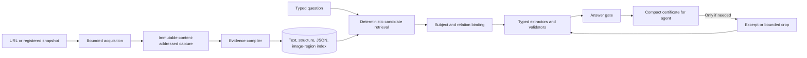

# LWA-Web v2: evidence gateway and answer certificates

**Status:** a first v2 implementation now exists in [scripts/evidence_gateway](../scripts/evidence_gateway/) with a [three-tool MCP server](../scripts/mcp_evidence_gateway.py), [usage guide](evidence-gateway-v2-usage.md), and [implementation report](evidence-gateway-v2-implementation-report.md). The architecture below remains the broader design contract; the usage guide identifies the implemented rule-based extraction limits. No matched agent evaluation of v2 has been run. The design is informed by the [20-item offline agent pilot](../results/experiment-03/offline-agent-pilot-run-20261021/report.md) and extends the [current MCP mitigation contract](lwa-web-mcp-mitigation-design.md). The v1 pilot achieved 15/20 exact reference matches with no matched baseline; therefore accuracy and token-saving goals below are not measured v2 improvements.

## Design decision

Build an **evidence compiler** that processes a capture once, a **typed resolver** that retrieves and checks question-specific facts, and an **answer gate** that emits a small certificate the agent can use directly. Keep the expensive source material server-side. The agent receives a concise result and requests a crop or source excerpt only when the certificate is unresolved or disputed.

This separates three costs that the current MCP mixes together: acquiring/rendering a page, compiling reusable evidence, and answering each question. It also removes visual localization from the agent's normal path. A simple DOM fact should take one query call. An exact code in a banner should arrive with its own crop coordinates and neighboring label, rather than require repeated crop guesses.



## The boundary between deterministic and uncertain work

The same immutable capture, question specification, and versioned processing configuration should produce the same candidate ordering, evidence IDs, extracted DOM values, status, and response shape. Content-addressed storage, stable tie-breakers, fixed budgets, schema validation, and cached results enforce that property. A new acquisition event may have the same content bytes but a different observation time; keep those identities separate.

Pixels are harder. OCR and vision can misread `N` as `R`, a Bangla surname, or a percentage even at temperature zero. Multiple OCR transforms or two visual readings improve evidence but do not make a pixel transcription a mathematical proof. The system should record the readings and their agreement, return `ambiguous` when they conflict, and expose the exact crop for escalation. A frozen vision output can be replayed deterministically by caching it, but that makes the output reproducible, not necessarily correct. The answer gate should never silently promote a low-confidence visual guess to a verified fact.

## Inputs and interface

Use one common request for live and offline use. Offline mode accepts only a registered opaque snapshot ID; the registry maps that ID to permitted files and hashes. It does not accept an arbitrary local path from the agent. Live mode accepts a URL with request, byte, redirect, and wall-time limits, and records access failures. A client specifies the requested answer type, entity, qualifiers, temporal scope, and budget; the gateway can infer missing slots but must show the interpretation it used.

```json
{
  "source": {"kind": "snapshot", "id": "capture:..."},
  "question": "What is the international Mastercard code?",
  "answer_type": "exact_code",
  "subject": "US-Bangla international Mastercard offer",
  "qualifiers": {"route": "international", "card": "Mastercard"},
  "budget": {"max_wall_ms": 20000, "max_visual_regions": 3}
}
```

The MCP surface can be three tools:

1. `resolve_evidence(request)` opens or reuses a capture, performs bounded retrieval and verification, and returns the certificate. This is the normal one-call path.
2. `inspect_evidence(evidence_id, view)` returns one bounded text excerpt, structured record, or image crop with its coordinates and source hash. The certificate supplies IDs and crop coordinates; the agent does not have to guess them.
3. `verify_answer(certificate_id, proposed_answer)` validates that the proposed value, required qualifiers, and cited evidence match the certificate. An integrating host should use this validator before emitting an exact answer.

MCP tools alone cannot force every external agent to obey a verdict. For enforceable behavior, place the answer gate in a host adapter or API endpoint that constructs the final response from the certificate or blocks unsupported exact assertions. The agent remains useful for interpreting the user's question and explaining supported results, but it does not decide that an unverified value is verified.

## Capture and index

**Acquisition.** Save the requested URL, final URL, redirects, HTTP status, access state, locale, viewport, capture mode, acquisition time, and whether the observed state was initial HTML, hydrated, or an interactive state. Record which states were *not* inspected. Detect blocked/challenge pages before fact extraction. Passive network JSON, embedded JSON, and human-visible page evidence must remain distinct. API-only data never becomes a claim about what the page showed without a visibility link.

**Storage.** Store HTML, rendered DOM, screenshots, image assets, and passive JSON as immutable blobs keyed by SHA-256. A content-derived capture ID identifies the source bundle; a separate acquisition-event ID records when and how those bytes were seen. Query results reference the bundle and are cached by `(capture ID, normalized question specification, compiler version, extractor version, model version if used)`. This avoids duplicating the same HTML and images for each question, as the current per-query capture path can do. It also avoids the current time-dependent capture ID changing for identical bytes.

**Compilation.** Build several linked indexes once per capture:

- Text: visible DOM text and accessibility labels, ordered by node/card/section; independent extractor views remain provenance-tagged rather than merged into one supposed truth.
- Structure: DOM ancestry, adjacent labels, cards, tables, repeated rows, section titles, and viewport bounding boxes where rendering supplies them.
- Data: embedded and passively captured JSON with source time, JSON path, entity/variant/locale, and visibility status.
- Visual: screenshot tiles, image-to-element mappings, region coordinates, and OCR lines. Index likely banners/cards/controls first; do not OCR a whole long screenshot by default. For historical images without DOM geometry, use tiling and layout segmentation, explicitly marking the weaker spatial link.
- Coverage: which page state, selector, region, and image was inspected; which remains unknown. Absence from an inspected selector is not global absence or physical incompatibility.

Each evidence record gets a stable ID, source hash, modality, location, exact source span or crop, relation to the subject, and extraction method. Preserve the raw source, but return only question-relevant records. Do not use image filenames, benchmark references, or expected answers as extraction shortcuts.

## Typed resolution and evidence binding

The resolver first decomposes the question into a target entity, requested predicate, answer type, qualifiers, and time/scope. Deterministic lexical or structural retrieval finds candidate sections. Optional semantic retrieval may improve recall, but it only ranks candidates; it cannot establish truth. Stable ranking and tie-breakers make repeated runs reproducible. Candidate extraction and validation then depend on the answer type:

| Type | Binding and validation rule |
| --- | --- |
| Exact code or name | Copy the exact source string. For an image, bind the code/name to the same banner/card as the requested offer or person, inspect a bounded crop, compare independent readings, and preserve original script. Similar-looking strings are competing candidates, not interchangeable values. |
| Number, percentage, or date | Bind the value to its label, unit, entity, variant, and source time. Normalize locale for comparison while retaining the original display. A nearby `9%` cannot replace the requested `7%` coupon. |
| Set, rank, or position | Preserve ordering and container boundaries; an “eighth logo” refers to the eighth item in a named visual sequence, not the eighth image on the page. If the sequence boundary is uncertain, return ambiguity with the indexed strip/crops. |
| Instruction or procedure | Extract ordered action slots and qualifiers from the same source span. A response is complete only when every source-supported required action is present. For the oil example: `strain the oil` and `use it in curry` are distinct steps. |
| Status or absence | Require explicit source text for a positive/negative fact. An enabled Buy button is an affordance, not proof of stock. A missing selector option is `not_observed_in_scope`, not a statement about physical compatibility. |
| Conflict across sources/time | Align entity, variant, locale, modality, and time before comparing. Return both values and provenance if they genuinely conflict; otherwise label them as observations of different states. |

The answer gate uses a finite status vocabulary: `supported`, `corroborated_visual`, `ambiguous`, `contradicted`, `not_observed_in_scope`, `coverage_incomplete`, `access_blocked`, `stale`, and `source_conflict`. `supported` means a direct, subject-bound source span or record passed typed checks; it does **not** mean the real-world assertion is globally true. `corroborated_visual` means multiple readings agreed on saved pixels but exactness remains fallible. Neither `not_observed_in_scope` nor `coverage_incomplete` may be rendered as “does not exist.” For an exact visual answer with conflicting readings, return `ambiguous` and candidates, not a guessed code.

The visual escalation ladder should spend effort only where it can change the answer: inspect the linked text or DOM first, run local OCR on the selected region at a few useful scales, then make at most one bounded vision-model call if exact characters remain consequential and the budget permits. Compare readings character by character and check the label/code relationship within the same region. A calibrated policy may allow a `corroborated_visual` answer with that provenance; `ambiguous` requires another source, explicit user review, or an uncertainty response. Set any acceptance threshold on development data and report its held-out error rate. Avoid repeated full-page image calls.

A normal certificate should fit within a small fixed response budget, provisionally **600–900 text tokens**, with at most two or three supporting observations. This is a product budget to test, not a measured token saving. Example, with illustrative IDs and values:

```json
{
  "certificate_id": "cert:...",
  "capture_id": "capture:...",
  "status": "ambiguous",
  "answer_type": "exact_code",
  "value": null,
  "candidates": ["USBAIN10", "USBAIR10"],
  "evidence": [{"id": "region:...", "source_kind": "rendered_image",
                "anchor": "International Routes / Mastercard / 10% OFF",
                "crop": [320, 80, 860, 450]}],
  "reason": "Two exact visual readings disagree at character 6",
  "next_action": "inspect_evidence(region:..., crop)"
}
```

Do not embed raw HTML, all candidate observations, repeated screenshots, or base64 images in the normal response. `inspect_evidence` supplies a bounded excerpt/crop only on request, with original coordinates and a link to the parent evidence. The certificate should say what question interpretation and source scope it used, so the agent can catch a mismatched entity or timeframe without reading a large trace.

## Service budgets and telemetry

Enforce limits within the server for each request and session: acquisition time and bytes, number and dimensions of visual regions, OCR/vision invocations, response size, and nested MCP calls. A wall limit must include calls hidden inside Code Mode or another tool wrapper. A stopped request returns a structured unresolved status with completed coverage instead of timing out without a final answer. Cache page compilation and bounded visual crops across questions about the same capture.

Time limits can affect whether an uncached live request finishes, so strict replay determinism applies to a completed immutable capture and cached/versioned processing result. A timeout is recorded as its own outcome, never disguised as evidence that a fact is absent.

Measure separate costs: acquisition, indexing, retrieval, OCR, optional vision, client model input/output/image tokens, total latency, and provider-billed cost when available. A serialized payload's byte count is not a token count; neither is `bytes / 4`. Report cache hits and cache-cold results separately. Pin versions of OCR, vision model, tokenizer, and rules in every certificate for replay.

## How this addresses the pilot misses

| Pilot miss | Proposed mechanism | Remaining risk |
| --- | --- | --- |
| Chaldal eighth logo timed out while localizing crops | One-time visual sequence/region index and server-selected strip; return bounded uncertainty before the wall cap | Historical screenshots may lack enough layout information to establish the eighth item reliably. |
| US-Bangla `USBAIR10` instead of `USBAIN10` | Same-banner binding plus character-level comparison of independent crop readings; expose disagreement rather than assert a value | Agreeing OCR/vision systems can share the same error. |
| Shwapno `PUJA7` abstention with false `9%` claim | Bind `7%` and code within one coupon card; reject percentage/code combinations from different cards | Poor Bengali OCR or compressed pixels may leave the coupon unresolved. |
| Government oil instruction omitted `ছেঁকে` | Ordered procedural slot check requires the straining step and curry-use step in the response | Semantic parsing of Bangla instructions can still miss a qualifier. |
| 10 Minute School `লক্ষ্মী` instead of `লস্কর` | Exact-script entity extraction from the parent-name region, role binding, and conflicting-reading escalation | Source pixels may be ambiguous; no automatic verifier can guarantee a surname from a blurred image. |

The Biman blocked-page behavior should be retained. The timed-out download-count control needs explicit source/time conflict handling; it did not demonstrate that ability in the pilot.

## Build sequence and acceptance

1. **Foundation:** add a registered snapshot gateway, content-addressed deduplicated storage, stable evidence IDs, typed certificate schema, deterministic retrieval order, and server-enforced budgets. Reuse the current acquisition and crop code where sound. This phase gives safer replay and smaller responses before adding any vision model.
2. **Visual binding:** add rendered element-to-image geometry where available; index historical screenshots by regions; attach OCR text to the correct card, label, and subject. Make the server select crops. Add the exact-value disagreement path.
3. **Typed validators:** implement codes/entities/numbers, ordered instruction slots, explicit status logic, and temporal/source conflict reporting. Add `verify_answer` and a host adapter for enforced final answers.
4. **Matched evaluation:** use the existing 20 scored pilot items as a development/regression set, not as proof of generalization. Prepare new held-out pages and independently adjudicated answers. Compare the same agent, packet, questions, and budgets using current MCP, v2, and a matched non-LWA condition. Hard-isolate gold and arbitrary filesystem paths for the offline run. Measure exact answer accuracy, abstention and false-assertion rates, evidence-grounding precision, actual text/image token usage, latency, nested calls, and billed cost. Report cache-cold and warm results separately. Claim “less token heavy” or “better” only after those matched results.

The desired outcome is a **small, replayable evidence certificate** that lets an agent answer routine questions in one call and makes uncertain visual or temporal claims explicit. The core determinism is in source identity, retrieval order, checks, budgets, and response format. Exact visual perception remains probabilistic and must be evaluated rather than assumed solved.
